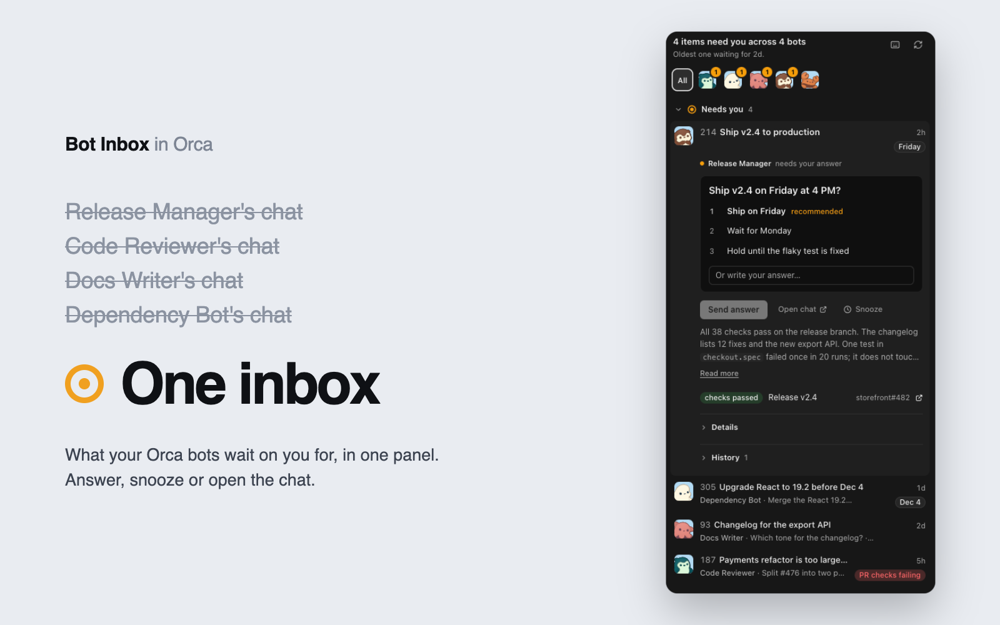
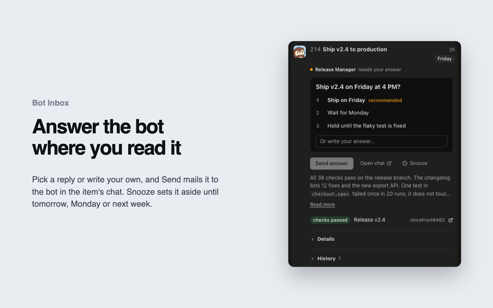

# Bot Inbox

Every item your [Orca](https://orca.dev) bots wait on you for, in one panel of the right sidebar, instead of one chat per bot. Answer a bot's question from the panel, snooze what can wait, and see the pull requests each item links to.



It reads the bots of the Orca on this computer through the `orca` CLI, keeps reading them while Orca runs, and counts what needs you in the status bar.

## What you get

- **What needs you, first.** The panel opens on how many items need you, at how many bots, and how long the oldest has waited. Items are grouped by status: **Needs you** and **In progress** open, **Waiting**, **Planned** and **Snoozed** folded. Within a group, an item with a deadline comes first, the nearest first, then the oldest. A strip of the bots' mascots filters the list by bot.
- **One row, two lines.** Each row shows the bot's mascot, the item's number and title, the question the bot asked or what it waits on, the bot's name, the age, and one chip: an overdue deadline, then failing checks on a linked pull request, then a deadline, then the pull request's state. A dot marks an item that needs you and that you have not opened yet.
- **Answer from the panel.** An unfolded item shows the decision first: each question the bot asks, its proposed replies with the recommended one marked, a field for your own answer, and **Send answer**, which posts the answer to the bot in the item's chat. The explanation, the description and the history follow, folded when long. **Open chat** shows the bot's workspace in Orca.
- **Triage from the row.** On hover or keyboard focus, a row that needs you offers the recommended reply in one press when the bot asks a single question, with four seconds to undo, and a clock that snoozes it until tomorrow.
- **Snooze.** Set an item aside until tomorrow, next Monday or a week out, each at 9 AM. It leaves its group and the count, and comes back on its day with a notification.
- **Status bar and notifications.** A status bar item counts the items that need you, amber when there is one, and opens the panel. A desktop notification names each item that newly needs you.
- **Keyboard.** `J` and `K` move between items, `Enter` sends the recommended reply, the arrows unfold and fold, `R` snoozes until tomorrow, `C` opens the bot's chat, `?` lists the shortcuts.
- **Linked pull requests.** The pull requests a bot linked to an item show with the state Orca last checked (checks failing, running or passed, draft, merged), each opening on GitHub.
- **English or French.** The **Language** setting (Settings, Plugins, Bot Inbox) follows the system language by default. Deadlines are read in both languages, whatever the panel speaks.



## Install

Needs Orca 1.4.248 or newer, with at least one bot.

In Orca, open Settings, then Plugins, search for **Bot Inbox** and install it. Or from a terminal:

```sh
orca plugin install ablause/orca-bot-inbox
```

Orca shows what the plugin may do and asks you to approve it. The panel appears as **Bot Inbox** in the right sidebar.

## What it is allowed to do

The plugin runs its own code on your machine, as you, which Orca marks as **Full access**: its worker is a Node process so it can run the `orca` CLI and read the bots' mascots from disk. Here is what that code does with it.

- **Your bots.** No plugin API lists bot items, so the worker runs `orca bot list` and `orca bot item list` for each bot, and `orca bot item show` when you unfold an item. Closed and canceled items are left out.
- **Your answers.** The only thing it ever sends is the answer you press **Send answer** (or the recommended reply) for, through `orca orchestration send` to the bot that owns the item, as a message in the item's chat. The item is read again first, so an answer never lands on a question already settled or answered.
- **Orca.** `workspace:write` is used only to show a bot's workspace when you press **Open chat**; `agent:read` to read the bots again when an agent's status settles; `notifications:show` for what newly needs you; `settings:own` for the language.
- **Storage.** It keeps your snoozes, the answers it sent and which items you have seen in its own storage (`storage:own`), by item number.

It never changes, closes or reassigns an item, makes no network call and keeps no analytics.

## Limits

- Tested on macOS. The mascots are read from the Orca app's own assets; a bot whose mascot cannot be found gets its initials.
- The bots are read every 45 seconds and once an agent's status settles, so a change made elsewhere can take that long to show.
- An answer is a message in the item's chat, not a click on the bot's own reply buttons: the bot reads it as it reads anything you write there.
- A bot with more than 500 open items is cut at 500, and the panel says so.
- Orca manifests cannot be localised, so the panel's title and command stay in English.

## Develop

```sh
npm install
scripts/orca-types.sh .
npm run check
npm test
orca plugin dev watch .
```

`npm install` writes no symlinks (see `.npmrc`): Orca refuses a plugin folder that holds one, and `orca plugin dev watch .` loads this folder as it is.

## License

[MIT](LICENSE). The bundled Preact, htm and Lucide icons keep their own licenses, in `src/vendor`.
